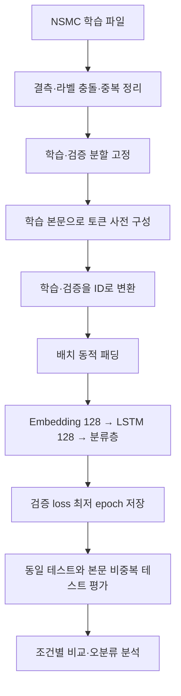
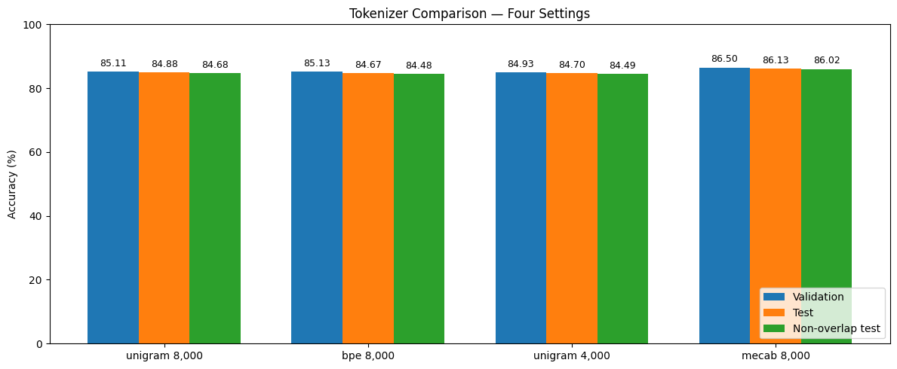
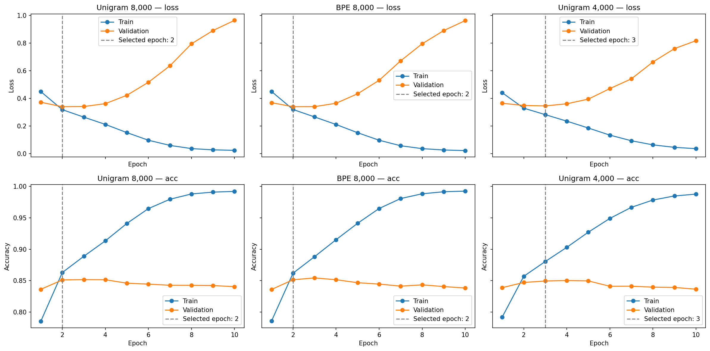
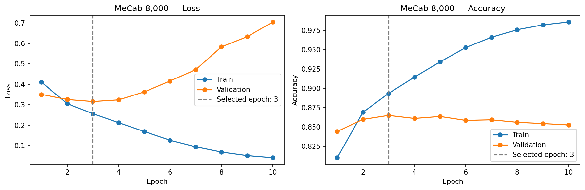

# SentencePiece와 MeCab으로 영화리뷰 감성 분류하기

ERICA × 모두의연구소 NLP · `01_Text_data` · 노드 1 「텍스트 데이터 다루기」, 노드 2 「멋진 단어사전 만들기」와 프로젝트.

NSMC 리뷰를 긍정·부정으로 분류하고 SentencePiece의 방식·사전 크기 및 MeCab을 비교했다. SentencePiece unigram 8,000의 테스트 정확도는 **84.88%**, MeCab 8,000은 **86.13%**였다.

**바로 보기:** [실행 결과가 남은 노트북](notebooks/sentencepiece_sentiment.ipynb) · [노드 1 학습 기록](learning/01_text_data.md) · [노드 2 학습 기록](learning/02_vocabulary.md) · [상세 실험 기록](analysis.md) · [학습 세션 안내](learning/README.md)

## 1. 데이터

출처는 [NSMC](https://github.com/e9t/nsmc)의 ratings_train.txt·ratings_test.txt이다.

| 항목 | 리뷰 수 | 처리 |
|---|---:|---|
| 원래 학습 파일 | 150,000 | 본문 결측·공백, 라벨 충돌 본문 제외 후 중복 정리 |
| 정리한 학습 파일 | 146,025 | 부정 73,272 / 긍정 72,753 |
| 실제 학습 / 검증 | 116,820 / 29,205 | 80:20, seed=42, 라벨 비율 유지 |
| 원래 테스트 / 유효 테스트 | 50,000 / 49,997 | 본문 결측 3개 제외, 공백뿐인 본문 없음 |
| 본문 비중복 테스트 | 48,850 | 학습·검증과 같은 본문인 테스트 1,147행을 제외한 보조 평가 |

토큰 사전은 학습용 리뷰만으로 만들었다. 학습·검증 간 같은 본문은 0개다. “비중복”은 본문 문자열의 정확한 일치 기준이며 근접·의미 중복까지 제거한 것은 아니다. 감정 표현과 문장부호는 일괄 삭제하지 않았다.

## 2. 실행 흐름



SentencePiece unigram 8,000을 기준으로 BPE 8,000은 model_type만, unigram 4,000은 vocab_size만 바꿨다. MeCab은 별도 토큰화 파이프라인이며 학습 빈도 상위 형태소와 특수 토큰으로 8,000개 사전을 구성했다.

모든 모델은 batch size 64, Adam lr=0.001, seed=42, 최대 10 epoch, 검증 loss 최저 선택을 사용했다. 테스트 점수를 기준으로 checkpoint를 고르지 않았다.

## 3. 결과

| 토큰화 설정 | 평균 학습 토큰 수 | 선택 epoch | 검증 정확도 | 테스트 정확도 | 본문 비중복 테스트 |
|---|---:|---:|---:|---:|---:|
| unigram 8,000 | 17.36 | 2 | 85.11% | 84.88% | 84.68% |
| BPE 8,000 | 17.02 | 2 | 85.13% | 84.67% | 84.48% |
| unigram 4,000 | 20.25 | 3 | 84.93% | 84.70% | 84.49% |
| MeCab 8,000 | 18.77 | 3 | **86.50%** | **86.13%** | **86.02%** |

근거는 [원래 정밀도의 비교 CSV](results/tokenizer_comparison.csv), [노트북](notebooks/sentencepiece_sentiment.ipynb), [원본 셀과 파일 해시](results/source_manifest.json)다. 정확도는 CSV에서 0~1로 저장하고 위 표에서 %로 표시했다. 테스트 수는 네 실험 모두 같다.



MeCab의 정확도가 가장 높았고, SentencePiece 세 설정도 모두 test accuracy 80%를 넘었다. 이는 현재 모델과 단일 시드 조건의 결과다.



세 설정 모두 train loss가 감소하는 동안 validation loss는 초기 최저점 이후 상승했다. unigram 8,000·BPE 8,000은 2 epoch, unigram 4,000은 3 epoch를 선택했다. 10 epoch 안에서 double descent의 두 번째 하강은 관찰되지 않았다.



MeCab도 3 epoch 이후 과적합 양상을 보였다. 마지막 epoch 대신 검증 loss가 가장 낮은 3 epoch 파라미터로 테스트했다.

## 4. 주요 발견

1. **낮은 UNK 비율이 높은 정확도를 보장하지 않았다.** 검증 UNK 토큰 비율은 unigram 0.11%, MeCab 4.77%였지만 테스트 정확도는 MeCab이 1.25%p 높았다. UNK는 MeCab의 분석 실패가 아니라 제한된 ID 사전에 없는 형태소를 의미한다. 근거: 전체 원본 셀 147·152, [분석 기록](analysis.md#9-mecab-unk를-읽는-법).
2. **사전 축소는 모델을 줄였지만 입력을 길게 만들었다.** unigram 4,000은 Embedding 파라미터가 512,000개 적고 평균 토큰 수는 약 16.7% 많았다. 테스트 정확도 차이는 -0.18%p였다. 원본 셀 127·129·135.
3. **같은 분할 조각도 다른 예측으로 이어졌다.** “애니는 일본이 갑인듯.”은 두 방식의 토큰 조각이 같았지만 예측이 달랐다. ID와 학습된 파라미터도 달라 단일 리뷰의 분할만으로 원인을 확정할 수 없다. 원본 셀 121·123, [예측 CSV](results/test_review_predictions.csv).
4. **본문 중복을 제외해도 성능은 비슷했다.** unigram 84.88%→84.68%, MeCab 86.13%→86.02%였다. 전체 공식 테스트 구성을 유지한 점수와 비중복 보조 점수를 구별해 보고했다.

MeCab·SentencePiece는 정규화와 사전 구성도 달라 “형태소 분할 때문”이라는 인과 결론은 내리지 않았다. 한 시드이며 반복·유의성 검정은 하지 않았다. 실험마다 테스트를 중간 열람했으므로 완전히 봉인된 최종 holdout 실험이라고 주장하지 않는다.

## 5. 강사 노트북 대비 바꾼 것

- NSMC 학습/검증 분할을 고정하고 사전 학습에 검증·테스트 본문이 들어가지 않게 했다.
- sp_tokenize의 ID 리스트를 정수 텐서로 변환하고 UNK=0·PAD=1을 분리했다.
- 전역 최장이 아닌 배치 최장에 동적 패딩하고, 실제 길이를 이용해 LSTM에서 PAD 구간을 제외했다.
- 검증 loss로 checkpoint를 고르고 복원한 뒤 동일 테스트로 비교했다.
- 본문 중복 제외 보조 평가, UNK 통계, 오분류와 토큰 분할 비교를 추가했다.
- 예측·관찰·정정 기록을 남겼다. 별도 공개 사본은 강사 제공 강의 본문을 제외하고 직접 작성한 프로젝트 구간과 출력을 보존했다. 원본 전체 파일은 로컬에 보존했다.

## 6. 구조와 실행 방법

```text
01_Text_data/
├── README.md
├── analysis.md
├── notebooks/sentencepiece_sentiment.ipynb
├── learning/
│   ├── README.md
│   ├── 01_text_data.md
│   ├── 02_vocabulary.md
│   └── PRT_original.md
├── src/
│   ├── dataset.py
│   ├── model.py
│   ├── train.py
│   ├── evaluate.py
│   ├── figures.py
│   └── smoke_check.py
└── results/
    ├── tokenizer_comparison.csv
    ├── test_review_predictions.csv
    ├── four_experiments_accuracy.png
    ├── all_experiments_learning_curves.png
    ├── mecab_8000_learning_curves.png
    ├── *_history_from_output.csv
    ├── training_output_logs.txt
    ├── source_manifest.json
    └── review_verification.json
```

노트북은 Colab에서 표시된 순서대로 실행한다. Google Colab의 Python·CUDA 환경 외에 SentencePiece, KoNLPy와 작동하는 한국어 MeCab 사전이 필요하다. 원래 환경의 버전과 미검증 사항은 [환경 기록](environment.md)에 적었다. 새 런타임 전체 재실행을 완료했다고 주장하지 않는다.

`src/`는 프로젝트 셀의 Dataset·LSTM·학습·평가 코드를 분리한 사본이다. optimizer·criterion·device를 함수 인자로 명시해 전역 상태 의존을 줄였다. 노트북은 기존 실험 셀과 결과를 유지하므로 이 모듈을 import하도록 소급 변경하지 않았다.

PyTorch가 설치된 환경에서 작은 CPU 데이터로 모듈 연결을 확인하려면 `01_Text_data` 폴더에서 다음을 실행한다.

```bash
python -m src.smoke_check
```

이 점검은 패딩→모델→역전파·갱신→평가·예측의 연결을 확인하며, NSMC 전체 재학습이나 원래 정확도의 재현은 아니다. 학습 로그 CSV는 저장 stdout에서 표시 자릿수로 추출했다. 체크포인트 `.pt`와 SentencePiece `.model/.vocab`은 제공받지 않아 포함하지 않았고 재학습 시 생성된다.

[GitHub 전체 ZIP 다운로드](https://github.com/dbstpgns789-eng/ERICA_X_MODULABS_NLP/archive/refs/heads/main.zip) 후 `01_Text_data`를 열어도 된다. 제출 형식은 사용자가 선택한다. 기존 Colab 작업본은 [여기](https://colab.research.google.com/drive/1Fcg-IBql7LjUifelOQ8jdOynBWN1S1-5)에 있다. 이 Colab의 타인 접근 권한은 별도 확인하지 않았다.

## 7. 회고 KPT

### Keep

- 셀을 실행하기 전에 목적을 확인하고, 예상과 실제 출력을 연결해 기록했다.
- 같은 분할·시드·평가셋을 유지하며 토큰화 방식과 사전 크기를 나누어 비교했다.
- 정확도만 보지 않고 UNK·토큰 길이·학습 곡선·오분류를 함께 봤다.

### Problem

- 처음에는 사전이 작아져 파라미터가 줄면 속도도 빨라질 것으로 예상했다. 토큰열이 길어져 LSTM의 처리 단계가 늘어난다는 점을 함께 고려해야 했다.
- 토큰 분할의 확률을 감성 분류에 유리하다는 근거로 곧바로 연결하려 했다. 두 확률의 의미를 구별해야 했다.
- 전체 코드를 맡기면 각 셀을 뒤늦게 다시 질문하게 됐다. 실제로 셀 단위 설명과 실행 결과 확인으로 진행 방식을 바꿨다.
- “한 파일에 한 줄당 리뷰 하나”를 “리뷰당 파일 하나”로 적은 메모와 코드 셀에 들어간 설명 문장이 있었다. 원문과 정정을 구별해 보완했다.

### Try

- [ ] 같은 조건을 여러 시드로 반복해 평균과 변동을 비교한다.
- [ ] MeCab 사전 크기를 늘려 UNK 감소가 성능과 모델 크기에 미치는 영향을 측정한다.
- [ ] 정규화 규칙을 통일한 비교로 기본 정규화의 영향을 분리한다.
- [ ] 검증 데이터로 early stopping·정규화를 비교하고, 다음 실험의 테스트는 마지막까지 보류한다.
- [ ] 새 Colab 런타임에서 MeCab 설치부터 전체 실행을 확인한다.

## 8. LMS 루브릭 대응

| 기준 | 제출 근거 |
|---|---|
| 분석·전처리·SentencePiece·토크나이저 구현과 동작 | 노트북의 데이터 분석, train-only 사전, sp_tokenize·동적 패딩 출력 |
| Text Classifier 연결 및 test accuracy 80% 이상 | SentencePiece unigram 8,000: 84.88%, 비중복 84.68% |
| 다른 토크나이저 또는 다른 옵션과 체계적 비교 | BPE, unigram 사전 크기, MeCab의 네 조건 표·그래프·오분류 분석 |

원본 위치는 제공된 전체 노트북의 1기준 셀 번호다. 공개 사본의 셀 metadata에 원본 번호를 기록했다. 위 대응은 관찰한 근거 정리이며 채점 결과나 만점을 확정하는 의미가 아니다.

## 9. Peer Review Template

아래는 기존 저장소 템플릿에서 코더 이름만 채운 내용이다. 리뷰어 항목과 체크박스는 남겨 두었다.

# Peer Review Templete
- 코더 : 윤세훈
- 리뷰어 : 리뷰어의 이름을 작성하세요.


# PRT(Peer Review Template)
- [ ]  **1. 주어진 문제를 해결하는 완성된 코드가 제출되었나요?**
    - 문제에서 요구하는 최종 결과물이 첨부되었는지 확인
        - 중요! 해당 조건을 만족하는 부분을 캡쳐해 근거로 첨부
    
- [ ]  **2. 전체 코드에서 가장 핵심적이거나 가장 복잡하고 이해하기 어려운 부분에 작성된 
주석 또는 doc string을 보고 해당 코드가 잘 이해되었나요?**
    - 해당 코드 블럭을 왜 핵심적이라고 생각하는지 확인
    - 해당 코드 블럭에 doc string/annotation이 달려 있는지 확인
    - 해당 코드의 기능, 존재 이유, 작동 원리 등을 기술했는지 확인
    - 주석을 보고 코드 이해가 잘 되었는지 확인
        - 중요! 잘 작성되었다고 생각되는 부분을 캡쳐해 근거로 첨부
        
- [ ]  **3. 에러가 난 부분을 디버깅하여 문제를 해결한 기록을 남겼거나
새로운 시도 또는 추가 실험을 수행해보았나요?**
    - 문제 원인 및 해결 과정을 잘 기록하였는지 확인
    - 프로젝트 평가 기준에 더해 추가적으로 수행한 나만의 시도, 
    실험이 기록되어 있는지 확인
        - 중요! 잘 작성되었다고 생각되는 부분을 캡쳐해 근거로 첨부
        
- [ ]  **4. 회고를 잘 작성했나요?**
    - 주어진 문제를 해결하는 완성된 코드 내지 프로젝트 결과물에 대해
    배운점과 아쉬운점, 느낀점 등이 기록되어 있는지 확인
    - 전체 코드 실행 플로우를 그래프로 그려서 이해를 돕고 있는지 확인
        - 중요! 잘 작성되었다고 생각되는 부분을 캡쳐해 근거로 첨부
        
- [ ]  **5. 코드가 간결하고 효율적인가요?**
    - 파이썬 스타일 가이드 (PEP8) 를 준수하였는지 확인
    - 코드 중복을 최소화하고 범용적으로 사용할 수 있도록 함수화/모듈화했는지 확인
        - 중요! 잘 작성되었다고 생각되는 부분을 캡쳐해 근거로 첨부


# 리뷰어 회고(참고 링크 및 코드 개선 제안)
    # 리뷰어의 회고를 작성합니다.
    # 코드 리뷰 시 참고한 링크가 있다면 링크와 간략한 설명을 첨부합니다.
    # 코드 리뷰를 통해 개선한 코드가 있다면 코드와 간략한 설명을 첨부합니다.
